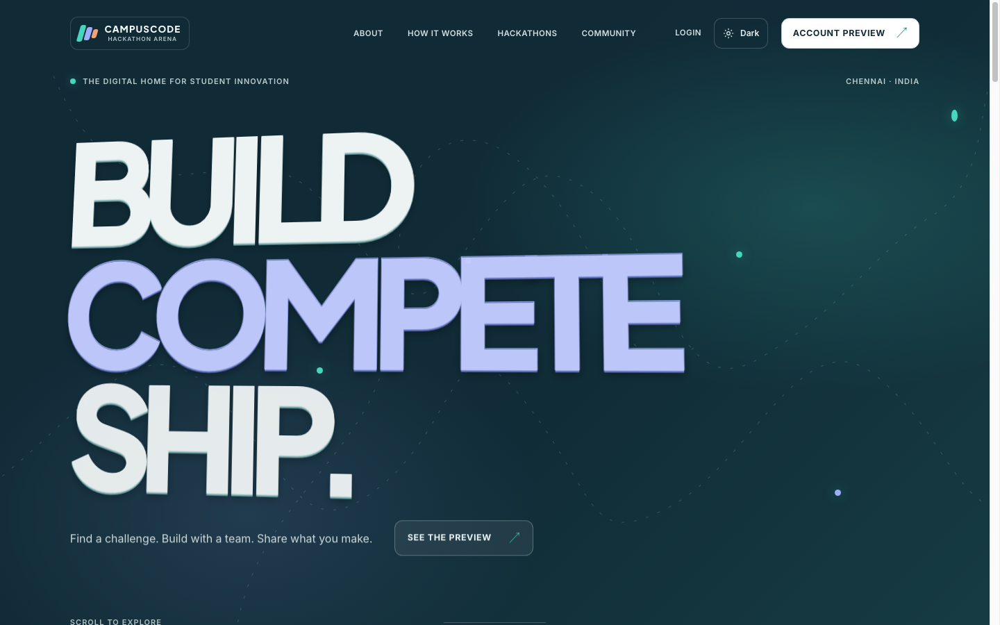
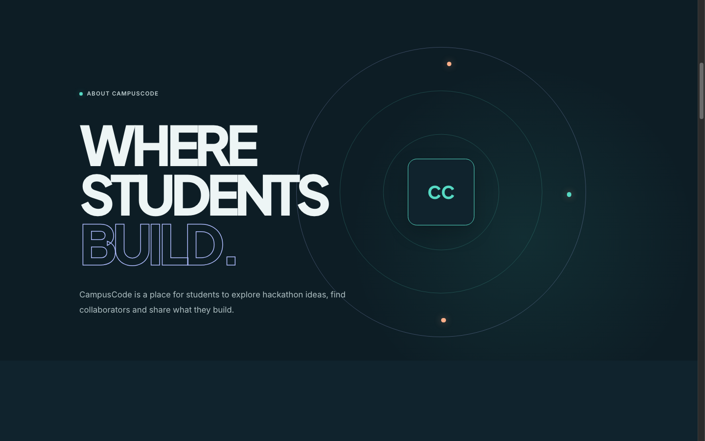
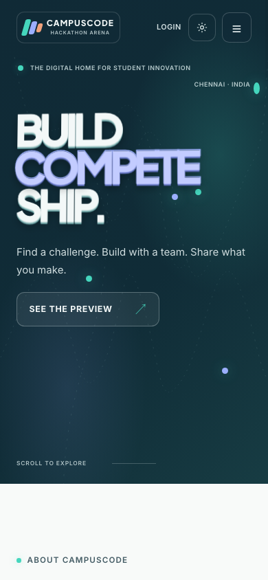
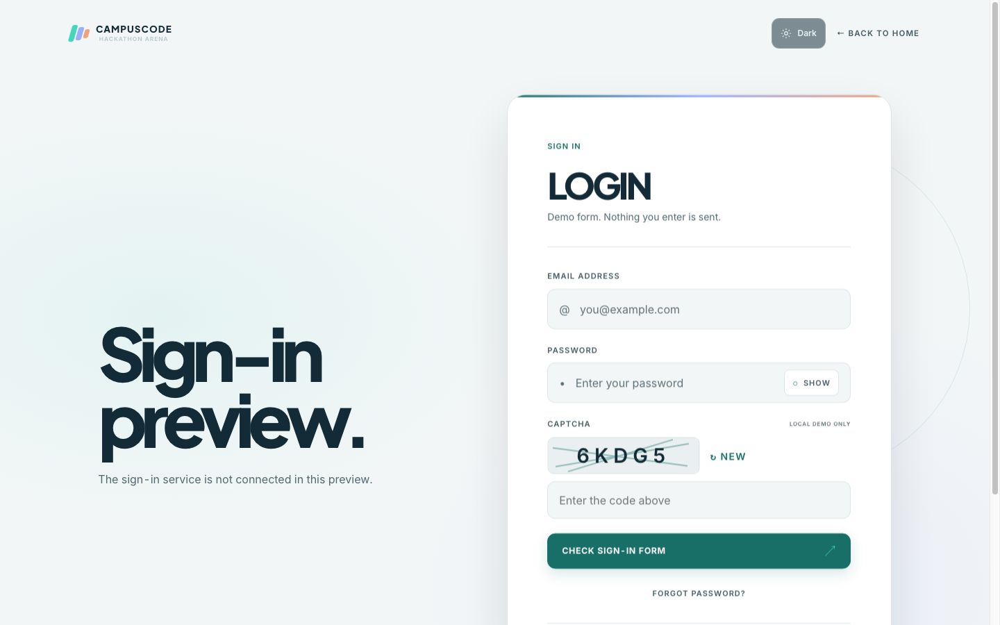
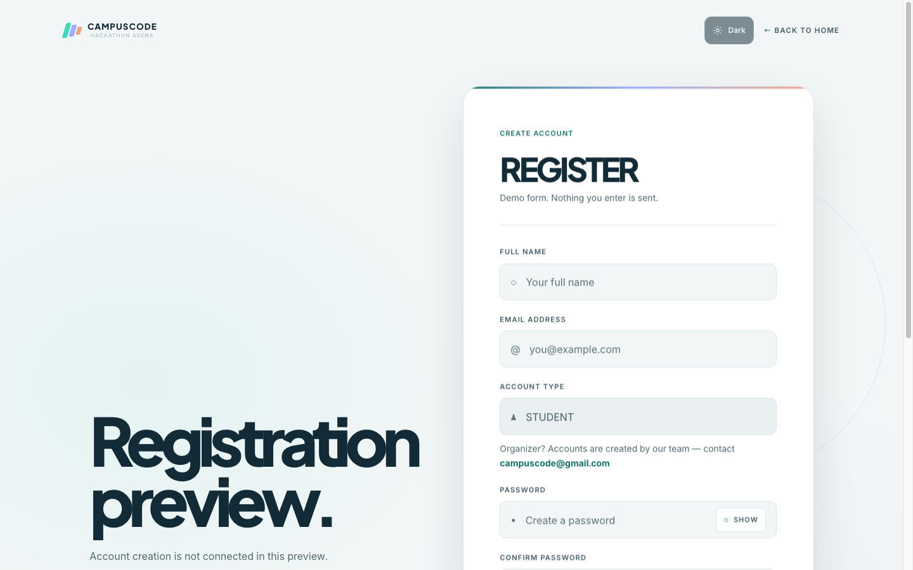

# CampusCode

An original, responsive public-facing CampusCode experience built with semantic HTML, CSS, vanilla JavaScript, and Vite. It includes a landing page plus frontend-only sign-in and registration previews. It is not a connected or authenticated dashboard.

## Screenshots

| Landing page | Dark theme | Mobile |
|---|---|---|
|  |  |  |

| Sign-in preview | Registration preview |
|---|---|
|  |  |

## Features

- Responsive landing page with section navigation and an animated “Build. Compete. Ship.” hero.
- Light and dark themes; the selected theme is saved in local storage.
- Sign-in and registration UI previews with form validation, password visibility controls, and a client-side CAPTCHA demonstration.
- Self-hosted Inter and Plus Jakarta Sans variable fonts.
- Reduced-motion support and keyboard-accessible navigation controls.

Authentication, account creation, email, password reset, and live hackathon data are not connected. Form data is not sent to a server.

## Technology

- HTML5, CSS, native JavaScript modules
- Vite 8
- Inter and Plus Jakarta Sans variable WOFF2 fonts (SIL Open Font License)

## Requirements

- Node.js 20.19+ or 22.12+
- npm

## Install and run

```sh
npm ci
npm run dev
```

Vite prints a local URL (usually `http://localhost:5173`). Stop the server with Ctrl+C.

## Production build

```sh
npm run build
npm run preview
```

The static output is written to `dist/`.

### GitHub Pages project site

For a project site served below `https://username.github.io/repository-name/`, copy `.env.example` to `.env.production.local`, set `VITE_BASE_PATH=/repository-name/`, then run `npm run build`. For a domain-root site, use `VITE_BASE_PATH=/`. The local environment file is ignored by Git.

## Project structure

```text
public/assets/fonts/  Font license notices
src/assets/fonts/     Self-hosted variable fonts
src/components/       Shared interface components
src/pages/            Landing, sign-in, and registration page modules
src/scripts/          Navigation, theme, form, and motion behavior
src/styles/           Design tokens and page/component styles
docs/                 Reference, design, QA, performance, and release notes
index.html             Landing page entry
login/index.html       Sign-in entry
register/index.html    Registration entry
vite.config.js         Vite build and base-path configuration
```

## Deployment

Not deployed yet. The project is prepared for static hosting; no deployment URL is available.

## Known limitations

- There is no backend, authentication, user account, email service, or live hackathon feed.
- The sign-in, registration, and CAPTCHA controls are demonstrations only.
- Screenshots document the current frontend preview and do not imply backend functionality.
- No automated accessibility audit or real-device testing has been performed.

See [docs/PROJECT-STATUS.md](docs/PROJECT-STATUS.md), [docs/QA-REPORT.md](docs/QA-REPORT.md), and [docs/SECURITY-REVIEW.md](docs/SECURITY-REVIEW.md) for additional status and validation details.
